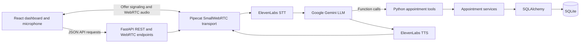

# NexovAI Doctor Appointment Assistant

A single-repository demo of a browser-based voice receptionist for doctor
appointments. The React dashboard reads clinic data from a FastAPI API. The
Pipecat voice endpoint connects a browser microphone to ElevenLabs speech
recognition, Google Gemini, SQLite-backed appointment tools, and ElevenLabs
speech generation.

> **Demo status:** Backend appointment logic and frontend code have automated
> tests. Real microphone-to-provider conversations require valid local
> ElevenLabs and Google credentials. See [PROJECT_STATUS.md](PROJECT_STATUS.md)
> for the current test evidence and remaining verification.

## Features

- View doctors, specialities, fees, appointments, and available times.
- Book and cancel appointments through FastAPI and SQLite.
- Use a browser call panel with live transcript, connection state, timer,
  microphone mute control, and Pipecat audio-level bars.
- Use Gemini function calling to check real availability and invoke the
  existing booking/cancellation services.
- Confirm the spoken phone number before appointment actions; confirm the
  selected doctor/time before booking and the exact appointment before
  cancellation.
- Prevent double-booking with an atomic slot update and a SQLite unique index
  for active appointments.
- Refresh the dashboard after an appointment change and highlight the affected
  record.

The app does not use browser speech recognition or speech synthesis as a
replacement for the server voice pipeline.

## Technology stack

| Area | Technology |
|---|---|
| Backend API | Python 3.12, FastAPI, Uvicorn |
| Voice orchestration | Pipecat 1.17.0, SmallWebRTC |
| Speech-to-text | ElevenLabs |
| LLM and function calling | Google Gemini |
| Text-to-speech | ElevenLabs |
| Persistence | SQLite, SQLAlchemy |
| Frontend | React 19, Vite 7 |
| Browser voice client | Pipecat client SDK and SmallWebRTC transport |
| Tests | Python `unittest`, Vitest |

## Architecture



The dashboard uses JSON endpoints for clinic data. For voice, the browser sends
the WebRTC offer to FastAPI's `/api/offer` endpoint; the Pipecat transport then
receives microphone audio and returns generated audio. Provider credentials
stay in the backend environment.

## Folder structure

```text
nexovai-doctor-assistant/
|-- backend/
|   |-- app/
|   |   |-- voice/
|   |   |   |-- pipeline.py
|   |   |   |-- routes.py
|   |   |   `-- tools.py
|   |   |-- database.py
|   |   |-- main.py
|   |   |-- models.py
|   |   |-- routes.py
|   |   |-- schemas.py
|   |   `-- services.py
|   |-- tests/
|   |-- init_db.py
|   `-- requirements.txt
|-- frontend/
|   |-- src/
|   |   |-- components/
|   |   |-- pages/
|   |   |-- services/
|   |   |-- App.jsx
|   |   |-- main.jsx
|   |   `-- styles.css
|   |-- .env.example
|   |-- package.json
|   `-- vite.config.js
|-- .env.example
|-- .gitignore
|-- PROJECT_STATUS.md
`-- README.md
```

`backend/appointments.db`, `backend/.venv`, and `frontend/node_modules` are
local generated files and are excluded from Git.

## Prerequisites

- Windows 10/11 and PowerShell.
- Python 3.12 (the backend test environment uses Python 3.12).
- Node.js 22.x and npm.
- Chrome or Edge for microphone/WebRTC testing.
- ElevenLabs API key and voice ID, plus a Google Gemini API key, for a real
  provider-backed voice call.

Docker is not required. The application uses SQLite.

## Environment variables

From the project root, copy the example and edit it locally:

```powershell
if (-not (Test-Path .env)) { Copy-Item .env.example .env }
notepad .env
```

Set these values in the root `.env`:

| Variable | Required for | Description |
|---|---|---|
| `ELEVENLABS_API_KEY` | Voice | ElevenLabs API credential |
| `ELEVENLABS_VOICE_ID` | Voice | ElevenLabs voice identifier |
| `GOOGLE_API_KEY` | Voice | Google Gemini API credential |
| `GEMINI_MODEL` | Optional | Gemini model override; default is configured in the backend |
| `FRONTEND_ORIGINS` | Optional | Comma-separated local frontend origins; defaults allow Vite ports 5173 and 5174 |

The dashboard's optional frontend setting is in `frontend/.env.example`:

```powershell
Set-Location .\frontend
if (-not (Test-Path .env)) { Copy-Item .env.example .env }
```

It sets `VITE_API_BASE_URL=http://127.0.0.1:8000`. Never place provider keys in
the frontend `.env` or commit either `.env` file. `.env.example` contains
placeholders only.

## Installation and startup

Run commands in separate PowerShell terminals.

### 1. Backend and database

From the project root:

```powershell
Set-Location .\backend
python -m venv .venv
.\.venv\Scripts\Activate.ps1
python -m pip install --upgrade pip
python -m pip install -r requirements.txt
python init_db.py
python -m uvicorn app.main:app --reload --host 127.0.0.1 --port 8000
```

If PowerShell blocks activation, use the virtualenv executable directly:

```powershell
.\.venv\Scripts\python.exe -m pip install -r requirements.txt
.\.venv\Scripts\python.exe init_db.py
.\.venv\Scripts\python.exe -m uvicorn app.main:app --reload --host 127.0.0.1 --port 8000
```

The initializer creates the tables and idempotently adds four mock doctors and
future weekday slots. It does not erase existing appointments.

Verify the API and open Swagger UI:

- Health: <http://127.0.0.1:8000/health> (expected JSON: `{"status":"ok"}`)
- API documentation: <http://127.0.0.1:8000/docs>
- Doctors: <http://127.0.0.1:8000/api/doctors>
- Availability: <http://127.0.0.1:8000/api/availability>

To inspect the local SQLite database from `backend`:

```powershell
@'
import sqlite3
connection = sqlite3.connect("appointments.db")
print("tables:", connection.execute("SELECT name FROM sqlite_master WHERE type='table'").fetchall())
for table in ("doctors", "available_slots", "appointments"):
    print(f"{table}:", connection.execute(f"SELECT COUNT(*) FROM {table}").fetchone()[0])
connection.close()
'@ | python -
```

### 2. React dashboard

In another terminal, from the project root:

```powershell
Set-Location .\frontend
if (-not (Test-Path .env)) { Copy-Item .env.example .env }
npm.cmd ci
npm.cmd run dev
```

Open the URL Vite prints, normally <http://localhost:5173>. If another local
service uses that port, Vite may choose 5174; both default ports are allowed by
FastAPI CORS. For a different port, add the exact origin to
`FRONTEND_ORIGINS` in the root `.env` and restart FastAPI.

## Voice pipeline

The implemented backend flow is:

1. `SmallWebRTCTransport` receives browser microphone audio.
2. `ElevenLabsSTTService` produces user transcription.
3. Pipecat's LLM context supplies conversation history and registered tools to
   `GoogleLLMService`.
4. Gemini can call the Python availability, booking, or cancellation handlers.
   Those handlers call the existing service functions and SQLAlchemy session;
   they do not simulate database success.
5. `ElevenLabsTTSService` turns the assistant response into audio.
6. Pipecat sends the audio back through WebRTC; `PipecatClientAudio` plays it.

Each call has its own conversation context and appointment-tool confirmation
state. The caller must speak the phone number, confirm its read-back, and
explicitly confirm booking or cancellation details. The code and service tests
cover these guards. Live Gemini interpretation, ElevenLabs STT/TTS, and
connected browser controls still require a provider-backed test; do not treat
the service tests as proof that a live call works.

## API endpoints

| Method | Path | Purpose |
|---|---|---|
| `GET` | `/health` | Backend process health |
| `GET` | `/api/doctors` | List doctors |
| `GET` | `/api/availability` | List open future slots; optional `doctor_id` and `appointment_date=YYYY-MM-DD` |
| `POST` | `/api/appointments` | Book a slot using `phone_number`, `doctor_id`, `slot_id`, optional `patient_name` |
| `GET` | `/api/appointments` | List appointments; optional `status=booked` or `status=cancelled` |
| `POST` | `/api/appointments/cancel` | Cancel using `phone_number` and `appointment_id`; ownership is checked |
| `POST` | `/api/offer` | Start WebRTC signaling for a voice session |
| `PATCH` | `/api/offer` | Apply WebRTC ICE candidate updates |

Example booking body:

```json
{
  "phone_number": "+91 98765-43210",
  "doctor_id": 1,
  "slot_id": 1,
  "patient_name": "Asha"
}
```

Example cancellation body:

```json
{
  "phone_number": "+91 98765-43210",
  "appointment_id": 1
}
```

The API normalizes phone formatting before matching. The phone number is the
demo's patient identifier; there is no separate patient account.

## Testing

Run backend service, tool, confirmation, and API tests:

```powershell
Set-Location .\backend
.\.venv\Scripts\python.exe -m unittest discover -s tests -v
```

Run frontend tests and a production build:

```powershell
Set-Location .\frontend
npm.cmd test
npm.cmd run build
```

For manual API tests, use Swagger at <http://127.0.0.1:8000/docs>. For manual
browser tests, verify navigation, doctors, availability filters, booking and
cancellation refreshes, then test a real call in Chrome/Edge with configured
credentials and microphone permission. A green build or tool-level test does
not verify external provider behavior.

## Known limitations and safe use

- This is an assignment/demo, **not a production healthcare system**.
- There is no authentication or authorization for the dashboard or API. The
  appointments endpoint returns patient phone numbers; do not expose this
  service publicly or use real patient information.
- Provider-backed voice behavior has not been verified in this workspace
  without local ElevenLabs and Google credentials.
- The demo has no TURN server configuration; WebRTC connectivity can vary
  across restrictive networks.
- SQLite is suitable for the local single-instance demo, not a concurrent
  production deployment.
- The frontend production build currently reports a JavaScript chunk over
  Vite's 500 kB advisory threshold.
- See [PROJECT_STATUS.md](PROJECT_STATUS.md) for verified results, blockers,
  and submission-readiness status.
